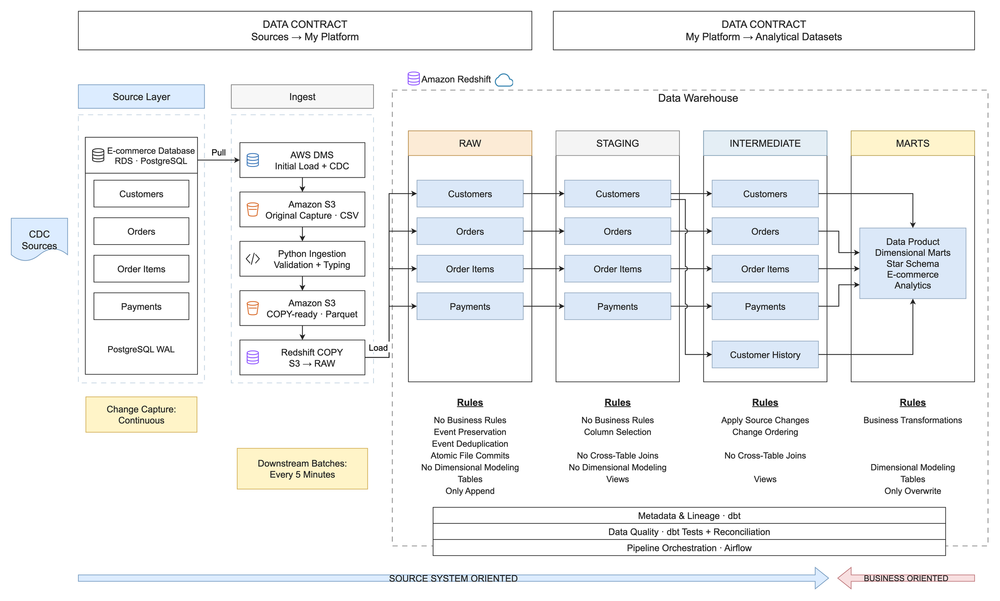
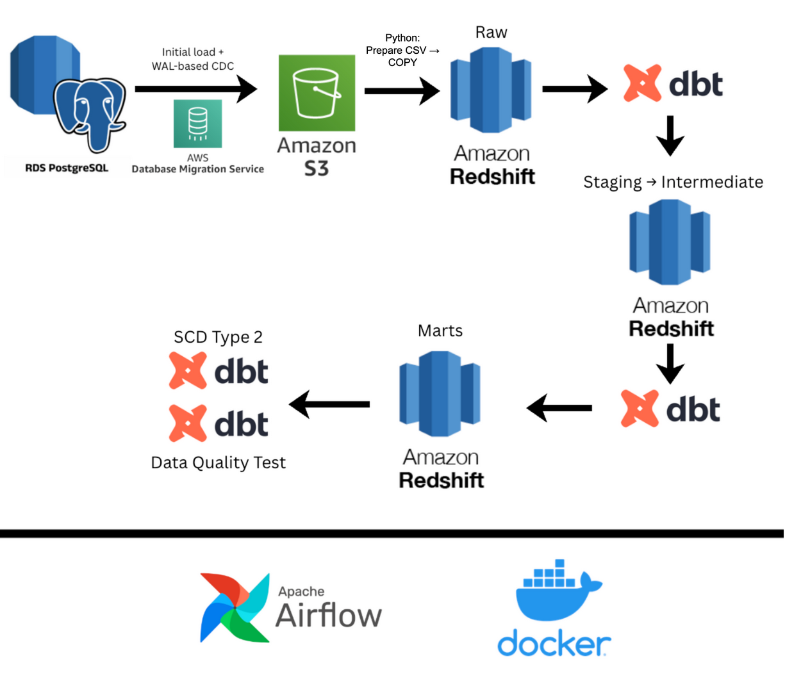
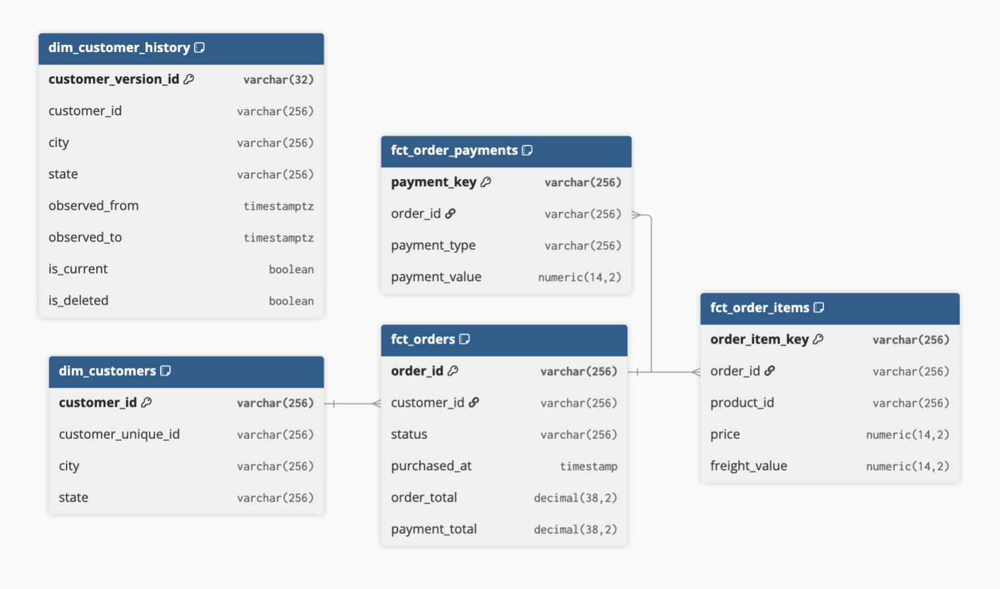

# E-commerce CDC Pipeline

This AWS pipeline captures changes in PostgreSQL and builds e-commerce analytics
marts in Redshift. It uses the Olist dataset to demonstrate
change data capture (CDC), orchestration, dimensional modeling, and recovery
from failures.

The pipeline starts with **415,418 rows of real, anonymized historical data from
Olist's Brazilian e-commerce marketplace**. The dataset is a static export of
actual business records across four tables: customers, orders, order items, and
payments. Python then simulates new orders, updates, and deletes to demonstrate
ongoing change capture. PostgreSQL generates real write-ahead logs (WAL), which
AWS DMS reads to capture these changes.

## Technical highlights

- **Log-based CDC:** AWS DMS loads the initial data from RDS PostgreSQL, then
  captures inserts, updates, and deletes.
- **Python and warehouse ingestion:** Python keeps the original CSV files in S3,
  prepares per-table CSV inputs, and loads Redshift with `COPY`. dbt staging converts
  source strings into numbers and timestamps.
- **Reliable processing:** retain delivered events in raw, deduplicate them in
  staging, apply changes in source order, and handle hard deletes.
  Raw rows and the record of their loaded file
  commit in one transaction, so a failed load can be retried safely.
- **SQL and dimensional modeling:** dbt builds staging and intermediate views,
  then five marts. Customer SCD Type 2 history keeps earlier customer versions.
  Items and payments are aggregated separately to avoid double-counting totals.
- **Orchestration:** Airflow runs locally in Docker every five minutes. It skips
  warehouse work when no files have changed and marks a batch complete only after
  builds and tests pass. Raw loading is incremental; each batch with new data
  fully rebuilds the marts.
- **Data quality:** source-to-target reconciliation checks that warehouse data
  matches the source. dbt tests check the models. GitHub CI uses temporary
  PostgreSQL test databases and checks Airflow task states.

## Data architecture

## Vendor architecture

All Redshift icons refer to layers in the same Redshift Serverless warehouse.
dbt builds customer history and tests the models. Airflow starts downstream
microbatches every five minutes.

## Simplified marts schema

| Mart | Grain — one row per |
|---|---|
| `dim_customers` | Current customer record |
| `dim_customer_history` | Observed customer version or deletion marker |
| `fct_orders` | Current order, with item and payment totals |
| `fct_order_items` | Current order item |
| `fct_order_payments` | Current payment entry |

Orders join to current customer details. A separate table keeps SCD Type 2
history. The diagram shows selected columns and logical relationships.

## Validation

| Evidence | Result |
|---|---|
| October 14 AWS revalidation (UTC) | Backfilled all 415,418 historical rows. All 14 models and 40 dbt tests passed after the backfill, CDC updates, and replay. Field-by-field reconciliation and failed-load recovery passed. |
| Local checks (October 13) | 93 tests passed with small disposable PostgreSQL fixtures. |

The October 14 run validates the current CSV loader, raw strings, staging checks,
and rebuilt marts. See [Test results](docs/validation.md) for detailed evidence
and earlier runs.

## Run the project

AWS compute runs during demonstrations and is deleted afterward. Verified data
is retained for replay and future demonstrations.

See [Documentation](docs/README.md) for AWS setup, local development, simulated
workloads, cleanup instructions, and technical details.
